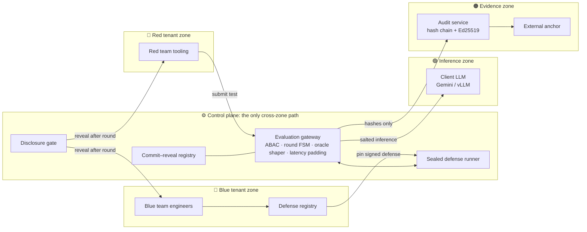

<div align="center">

# 🛡️ BAYORA

### Sealed-room infrastructure for adversarial AI safety testing

**Run together. Leak nothing. Prove it.**

Red team, blue team and the client LLM run side by side, each in its own sealed zone.
They talk only through one shaped, audited gateway.

[Live demo](https://bayora-l6eq.onrender.com/) · [Quick start](#-quick-start) · [API](#-api-reference) · [Deploy](#-deployment)


*Hack in Hills · Problem Statement 04: AI Safety & Security · Team **The Matrix***

</div>

---

## 📌 Table of contents

- [The problem](#-the-problem)
- [How Bayora solves it](#-how-bayora-solves-it)
- [What's in the prototype](#-whats-in-the-prototype)
- [Architecture](#-architecture)
- [Quick start](#-quick-start)
- [Configuration](#️-configuration)
- [Scripts](#-scripts)
- [API reference](#-api-reference)
- [Deployment](#-deployment)
- [Security notes](#-security-notes)
- [Roadmap](#️-roadmap)
- [Team](#-team)

---

## ❓ The problem

Today, red teams, blue teams and the model under test usually share one Docker sandbox. That lets information leak across tenants:

- **Payloads leak.** The blue team can see red's attacks before a round ends.
- **Defenses leak.** Red can infer blue's rules through repeated oracle probing or response timing.
- **Model state leaks.** Shared KV / prefix caches expose other tenants' prompts through timing side channels.
- **Evidence can be rewritten.** An admin can edit the logs after the fact.

Any one of these silently invalidates a safety finding. An unsafe model can then ship as "tested".

## ✅ How Bayora solves it

| Risk | Plain Docker sandbox | Bayora |
|---|---|---|
| Blue sees red payloads | Yes, inline | Never before reveal |
| Defense inferable by probing | Unlimited queries | Coarse verdicts + per-round query budget |
| Defense inferable by timing | Yes | Constant-latency padding on every reply |
| KV / prefix-cache cross-leak | Shared prefixes | Salted per run |
| Admin can rewrite logs | Yes | Hash-chained, signed, externally anchored |
| Proof nobody changed mid-round | None | Commit–reveal hashes |

Every evaluation follows a lifecycle that the gateway enforces as a state machine:

```
CREATED → COMMIT → LOCK → EXECUTE → SEAL → REVEAL → VERIFY → COMPLETED
```

1. **Commit.** Red and blue post hashes of their payloads and defenses.
2. **Lock.** The defense is frozen and the runtime is attested.
3. **Execute.** Attacks go through the shaped oracle with a fixed budget and fixed latency.
4. **Seal.** Evidence is hashed and the audit chain is checkpointed.
5. **Reveal.** The gate opens and committed hashes are checked against what ran.
6. **Verify.** Anyone can replay the audit chain against the anchor.

## 🧩 What's in the prototype

| Module | What it does |
|---|---|
| **Round Wizard** | Steps through all 8 phases of the sealed state machine, with role switching (Admin / Red / Blue / Auditor) |
| **Canary secrets** | Generates a confidential canary with Web Crypto and embeds it in the system prompt. Red never sees it, so any leak is provable. |
| **Shaped oracle** | Returns coarse verdicts only (blocked / passed / timeout) under a per-round query budget (default 50) |
| **Constant latency** | Pads every reply to a fixed deadline (default 1500 ms) so timing reveals nothing |
| **Sealed Runner** | Runs blue-team defense code in a sandbox with a strict CSP |
| **Cryptographic Ledger** | Keeps a hash-chained audit log with Ed25519 signed checkpoints |
| **ABAC & Deny Matrix** | Enforces attribute-based access between roles and resources |
| **Oracle & Cache Lab** | Shows timing side-channel experiments, plus live vLLM KV-cache metrics when connected |
| **AI red / blue agents** | Gemini generates jailbreak attacks, adaptive follow-ups and draft defenses at runtime |
| **Guided Demo (90 s)** | Gives judges and reviewers a one-click walkthrough of a full round |

> All dashboard data is produced at runtime. Nothing comes from fixtures.

## 🏗 Architecture



**Tech stack**

| Layer | Technology |
|---|---|
| Languages | TypeScript · Python |
| Frontend | React 19 · Vite · Tailwind CSS |
| Backend | Express · TypeScript (Node.js 18+) |
| Inference | Google Gemini (primary and fallback models) · optional vLLM server |
| Crypto | Web Crypto · SHA-256 · Ed25519 |
| Telemetry | Prometheus metrics scraped from vLLM |

## 🚀 Quick start

**Prerequisites:** Node.js 18 or later (tested on 20, 22 and 24), Python 3 and a [Google Gemini API key](https://aistudio.google.com/app/apikey).

```bash
# 1. Clone and install
git clone <your-repo-url> bayora
cd bayora
npm install --legacy-peer-deps

# 2. Configure secrets
cp .env.example .env.local
#    then edit .env.local and set GEMINI_API_KEY

# 3. Run
npm run dev
```

Open **http://localhost:3000** and click **▶ Guided Demo (90s)** to watch a full sealed round.

> Without `GEMINI_API_KEY`, the UI still loads, but the live LLM endpoints return `503`. See the [API reference](#-api-reference).

## ⚙️ Configuration

Set these in `.env.local` for local development, or in your host's environment-variables dashboard.

| Variable | Required | Default | Description |
|---|---|---|---|
| `GEMINI_API_KEY` | **Yes**, for live AI | — | Google Gemini API key used for inference and the red/blue generator agents |
| `GEMINI_MODEL` | No | `gemini-3.8-flash` | Primary model ID |
| `GEMINI_FALLBACK_MODEL` | No | `gemini-3.5-flash-lite` | Model used when the primary returns `503` / `429` |
| `PORT` | No | `3000` | Express server port. Hosts that inject `$PORT` override it |
| `NODE_ENV` | No | `development` | `development` or `production` |
| `VLLM_BASE_URL` | No | — | Base URL of a vLLM server (e.g. `http://localhost:8000`) for live KV-cache metrics |

Example `.env.local`:

```env
GEMINI_API_KEY=your-gemini-api-key
GEMINI_MODEL=gemini-3.8-flash
# VLLM_BASE_URL=http://localhost:8000
```

## 📜 Scripts

| Command | Purpose |
|---|---|
| `npm run dev` | Starts the dev server with hot reload |
| `npm run lint` | Type-checks the TypeScript project |
| `npm run build` | Builds the optimized frontend bundle into `./dist` |
| `npm start` | Starts the production server (use with `NODE_ENV=production`) |

Before you push, run:

```bash
npm run lint && npm run build
```

## 📡 API reference

### `GET /api/health`

Reports server status and which backends are configured.

```json
{
  "status": "ok",
  "geminiConfigured": true,
  "geminiModel": "gemini-3.8-flash",
  "vllmConfigured": false,
  "time": "2026-10-27T12:00:00.000Z"
}
```

### `GET /api/vllm/metrics`

When `VLLM_BASE_URL` is set, this fetches and parses Prometheus metrics from `${VLLM_BASE_URL}/metrics`. Otherwise it returns:

```json
{
  "connected": false,
  "status": "unavailable",
  "message": "vLLM not connected - cache metrics unavailable",
  "metrics": null
}
```

### Live LLM and red-teaming

| Method | Endpoint | Description |
|---|---|---|
| `POST` | `/api/llm/query` | Queries the model under evaluation with a prompt and system prompt |
| `POST` | `/api/llm/generate-attacks` | Red-team agent generates diverse jailbreak attacks |
| `POST` | `/api/llm/generate-defense` | Blue-team agent drafts sandboxed defense functions |
| `POST` | `/api/llm/adaptive-attack` | Generates follow-up attacks from prior coarse verdicts |

If `GEMINI_API_KEY` is missing, all four endpoints return:

```http
HTTP/1.1 503 Service Unavailable
{"error": "GEMINI_API_KEY not configured on server"}
```

## 🌐 Deployment

Every host uses the same two commands:

| Step | Command |
|---|---|
| Build | `npm install --legacy-peer-deps && npm run build` |
| Start | `NODE_ENV=production npm start` |

On every host, set `GEMINI_API_KEY` and `NODE_ENV=production`. `GEMINI_MODEL` and `VLLM_BASE_URL` are optional.

<details>
<summary><b>Render</b></summary>

1. Create a **New → Web Service** from your repository.
2. Set **Build Command** to `npm install --legacy-peer-deps && npm run build`.
3. Set **Start Command** to `NODE_ENV=production npm start`.
4. Under **Environment**, add `GEMINI_API_KEY`.

</details>

<details>
<summary><b>Railway</b></summary>

1. Choose **Deploy from GitHub repo**.
2. Under **Variables**, add `GEMINI_API_KEY` and `NODE_ENV=production`.
3. Under **Settings**, set the build command to `npm install --legacy-peer-deps && npm run build` and the start command to `npm start`.

</details>

<details>
<summary><b>Google Cloud Run</b></summary>

```bash
gcloud run deploy bayora \
  --source . \
  --set-env-vars NODE_ENV=production \
  --set-secrets GEMINI_API_KEY=gemini-api-key:latest \
  --allow-unauthenticated
```

This reads the key from Secret Manager, so it never appears in your shell history.

</details>

<details>
<summary><b>Docker / VM</b></summary>

```bash
npm install --legacy-peer-deps && npm run build
NODE_ENV=production PORT=3000 npm start
```

Put a reverse proxy (nginx or Caddy) in front for TLS.

</details>

## 🔐 Security notes

- **Keep secrets out of git.** `.env` and `.env.local` are listed in `.gitignore`. Only `.env.example`, with placeholder values, belongs in the repo.
- **Keep keys server-side.** The browser bundle contains no API keys, and every Gemini call goes through the Express server.
- **Rotate exposed keys.** If a key ever appears in a commit, README, screenshot or chat, revoke it in Google AI Studio and issue a new one. Deleting it from the latest commit is not enough, because git history keeps it.
- **Know the prototype's limits.** It demonstrates the protocol: sealed rounds, shaped oracle, constant latency and the signed audit chain. Kernel-level isolation (gVisor), per-zone networks and confidential computing belong to the production design. See the roadmap below.

## 🗺️ Roadmap

| Horizon | Item |
|---|---|
| **Next 3 months** | Kubernetes operator with `RuntimeClass = gVisor / Kata` · NVIDIA MIG GPU partitioning per tenant · CI/CD safety gates |
| **6–12 months** | Confidential computing (AMD SEV-SNP / Intel TDX / H100 CC) · adaptive red agents inside the sealed zone · differential-privacy oracle |
| **12 months +** | Federated evaluations across labs and AI Safety Institutes · public transparency log (Sigstore-style) · formally verified gateway (TLA+) |

## 👥 Team

**The Matrix**, Hack in Hills, Problem Statement 04: AI Safety & Security

| Member |
|---|
| Harsh Tyagi |
| Krushnai Pawar |
| Elizabeth Sabu |

Roles covered: Infra & Isolation · Gateway · LLM & Defense · Audit · UI

---

<div align="center">

**Run together. Leak nothing. Prove it.**

</div>
