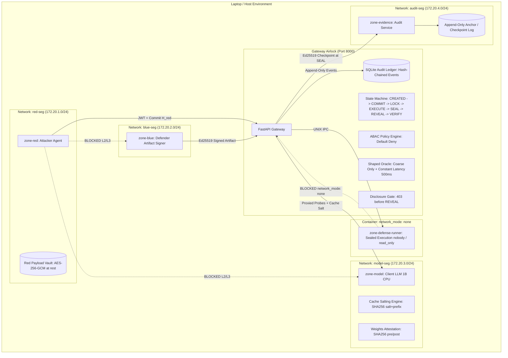

# Bayora Threat Model & Security Architecture

## 1. System Architecture Diagram (Mermaid)

---

## 2. Threat Coverage Analysis

### A. What is Fully Covered (Mitigated by Construction)
1. **Direct Cross-Zone Network Lateral Movement**: Red and Blue containers share zero Docker networks. Linux kernel network namespaces drop all packets between subnets.
2. **Payload Alteration Post-Execution (Repudiation)**: Canonical JSON + 32-byte nonce SHA-256 commitments submitted in `COMMIT`. Any post-hoc modification triggers hash mismatch and marks round `INVALID`.
3. **Out-of-Order Transition Attacks**: Strict linear progression (`CREATED -> COMMIT -> LOCK -> EXECUTE -> SEAL -> REVEAL -> VERIFY`). Skipping states returns `409 Conflict` and logs an incident.
4. **Token Hijacking & Stale Replay**: Short-lived signed JWTs with strict 10-minute maximum expiration. Expired tokens return `401 Unauthorized`.
5. **Cross-Zone Resource snooping**: ABAC evaluates `(role, action, resource, round_state)` with default-deny. Red reading Blue endpoints returns `403 Forbidden`.
6. **Premature Intelligence Gathering (Pre-Reveal Findings)**: Disclosure gate blocks `/findings` with `403 Forbidden` until `REVEAL`.
7. **Audit Trail Deletion or Manipulation**: Hash-chained events `entry_hash = SHA256(prev_hash + canonical_event)` with Ed25519 checkpoint signatures. Any edited entry is pinpointed with 100% accuracy.
8. **Output Over-Extraction (Model Stealing / Scoring)**: Shaped Oracle returns strictly `{blocked, passed, error, timeout}`. No confidence scores, reasoning chains, or generated text.
9. **Query Flooding & Exhaustion**: Strict per-round budget (50 queries) and cumulative budget. Query 51 returns `HTTP 429 Too Many Requests`.

---

### B. What is Partially Covered (Prototype Simplification vs. Production)
1. **Container Breakout & Kernel Shared Memory**:
   - *Prototype*: Standard Docker cgroups and non-root execution (`nobody:nogroup`, UID 65534).
   - *Production*: Configure **Kata Containers (microVMs)** or **gVisor (`runsc`)** for untrusted code execution.
2. **Payload Encryption Key Storage**:
   - *Prototype*: AES-256-GCM key stored in local Red Zone file/memory.
   - *Production*: Bind AES key to hardware **TPM 2.0 PCR state** or **AWS Nitro Enclave KMS attestation**.
3. **Model Memory Isolation & Weight Snooping**:
   - *Prototype*: Read-only volume mount with pre/post SHA-256 software attestation.
   - *Production*: Dedicated **NVIDIA Multi-Instance GPU (MIG)** instances inside an **AMD SEV-SNP** or **Intel TDX** confidential virtual machine.
4. **External Audit Anchor Storage**:
   - *Prototype*: Append-only local storage file with Ed25519 signatures.
   - *Production*: **AWS S3 Object Lock (Compliance WORM mode)** or Google Cloud Storage Bucket Lock with RFC 3161 hardware TSA.

---

### C. Residual Risks (Known Architectural Boundaries)
1. **Hardware Power & Physical EM Side Channels**: Physical co-location on identical bare-metal CPU silicon can theoretically leak side-channel power/frequency signals under extreme laboratory conditions. (Mitigated in production via separate physical server nodes).
2. **Denial-of-Service by Flawed Defense Code**: If Blue uploads a defense function that enters an infinite loop, the runner enforces a 100ms timeout and treats it as a block verdict.

---

### D. Out of Scope (By Design)
1. **Adversarial Safety Evaluation Strategy**: Bayora provides the sealed, uncheatable harness; designing sophisticated jailbreak prompts or superior defense heuristics is the responsibility of Red and Blue engineers.
2. **General Cloud Infrastructure Orchestration**: Provisioning underlying Kubernetes clusters or cloud VPC peerings is outside the application container boundary.
